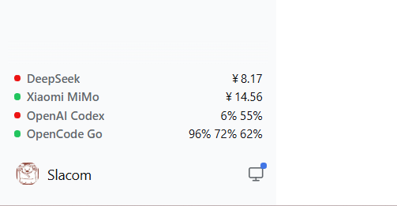

# dsh-usage-dock

[](https://www.npmjs.com/package/dsh-usage-dock)
[](https://github.com/Slacom/dsh-usage-dock/blob/main/LICENSE)

DeepSeek Harness（DSH）的侧栏套餐用量插件：在左侧栏底部显示余额和剩余额度，点击展开详情。

当前版本 **1.0.0**（2026-11-25）。内置渠道为 OpenCode Go、DeepSeek、OpenAI Codex、小米 MiMo；
WorkBuddy 已退场，MiMo 只保留 API Key 余额。发布说明见
[release-notes-v1.0.0.md](docs/release-notes-v1.0.0.md)。



## 支持渠道

| 渠道 | 数据来源 | 显示内容 |
| --- | --- | --- |
| OpenCode Go | OpenCode usage API（Bearer） | 5 小时 / 周 / 月窗口（按账户实际返回） |
| DeepSeek | DSH 账号余额优先，开放平台 API Key 回退 | 余额（含赠金）；账号模式附峰谷时间条 |
| OpenAI Codex | 本插件内登录 ChatGPT 账号（设备码；最多保存 8 个账户，单选切换） | 5 小时 / 周（账户实际返回的窗口） |
| Xiaomi MiMo | 开放平台 API Key（`mimoApiKey`，或「设置 → 模型」里的 MiMo Key） | 总余额、现金及赠送余额 |
| **自定义余额渠道** | 你选择的模型来源 + 该来源下的余额接口路径 | 该接口返回的余额（币种来自条目或可信采样） |

- 每 **30 秒**刷新；展开面板、窗口聚焦、页面重新可见时立即刷新。
- 短暂网络失败保留旧值（灰化显示），持续失败后才报告错误；未登录、缺凭据、鉴权失败等错误立即显示。
  是否算"持续失败"以 Host 给出的统一状态为准。
- OpenAI Codex 使用**本插件自己的 ChatGPT 账号登录**（设备码）：在
  「设置 → 内置插件 → Usage Dock → OpenAI Codex」点「添加账户」完成授权即可读取额度，
  **不需要**再安装 `dsh-codex-connect`，也不需要维护 `dsh-codex-subscription` 的本地补丁
  （旧的 Connect / Subscription 来源已退场，设置页与原生页都不再提供来源选择）。
  可以保存**多个账户**（最多 8 个）并单选切换：胶囊与详情只显示当前选中账户的数字，
  切换/移除都只动本插件自己的凭据记录，不写配置、不读写其它插件的登录状态，
  令牌也不会回显到页面。该方式读取的是 Codex 客户端使用的额度接口，属**非官方支持**用法，
  上游改版时可能失效。登录、重登、切换与移除入口只在**桌面网页版设置页**；
  手机端原生设置页只能查看并选择账户，不能完成登录或退出。
- 小米 MiMo **只用 API Key** 查余额：在「设置 → 内置插件 → Usage Dock → Xiaomi MiMo」填
  `mimoApiKey`，或在「设置 → 模型」里配置 `XIAOMI_API_KEY`
  （provider 名含 mimo/xiaomi 时也可自动取用）。没有 Key 时固定显示「未配置 API Key」；
  **没有**扫码登录、记住登录、控制台 Cookie 或「登录态过期」这一类入口与状态。
  自动复用「设置 → 模型」的 Key 时，只信任 `https://api.xiaomimimo.com` 来源。
- 1.0.0 加固：Codex 额度响应带脱敏采集代次，外部切换账户后旧值与迟到响应立即作废；
  已移除旧的 Codex 补丁 HTTP 写入口；网页切换账户失败会显示提示；移除最后一个账户改为
  原子空态写入，避免与并发新增账户互相覆盖。
- 胶囊独占侧栏底部一行，位于其他底部插件上方；侧栏折叠时只显示圆点，不可点击。
- 设置页可开关渠道、配置凭据、设置余额告警阈值与显示顺序（内置与自定义渠道在同一列表里混排）。
- 余额向下取整到分。DeepSeek / MiMo 的「侧栏显示告警额度」默认 10 元，填 0 不告警。
  这个告警只影响侧栏胶囊状态灯，和下面的「额度策略」是两套东西。

### 已退场渠道：WorkBuddy（1.0.0）

WorkBuddy **不再作为本插件的原生 / 内置渠道**（用户不再使用反代渠道）：

- 没有 WorkBuddy 专用开关、积分口径、账号筛选，原生额度面板里也没有 WorkBuddy 分组；
  旧配置里的 WorkBuddy 字段保留但不生效，`workbuddy` / `workbuddy-ai` 两个 id 都属退场渠道
  （不取数、不复活）。
- **如仍需要，请用「自定义余额渠道」添加**：在「设置 → 模型」里选已有的 WorkBuddy2API 来源，
  再填该来源下的余额接口路径（例如 `/v1/credits`）与结果 JSON 键路径，见下一节。
- 历史发布说明（≤ 0.11.3）里的 WorkBuddy 记录只作沿革，不代表当前版本。

## 自定义余额渠道

在「设置 → 内置插件 → Usage Dock」里可以添加多条自定义渠道。每条选择一个**已在「设置 → 模型」中配置的
来源**，再填写该来源下的余额接口路径：

| 字段 | 说明 |
| --- | --- |
| 名称 | 仅用于显示；同名多条互不影响 |
| 余额来源 | 从已配置的模型来源里选择；接口主机与凭据都由它派生，不需要另填 URL 或 Key |
| 余额接口路径 | 相对该来源的路径，例如 `/v1/credits` 或 `/balance` |
| 结果 JSON 键路径 | 例如 `data.balance`、`balance_infos[0].total_balance` |
| 币种（可选） | 留空表示未指定，插件不会替你猜成人民币 |

可选「扣减键」表达 `余额键 − 扣减键`，用于「累计额度 − 累计用量」这类响应。

能力边界：

- **只支持** `GET` + `Authorization: Bearer <凭据>` + JSON 响应；不做 Cookie、OAuth、签名、
  GraphQL、网页抓取或特殊厂商适配。
- 键路径只支持字段名与数组下标，**不执行任何表达式**（没有通配、过滤器或 eval）。
- 只访问你**明确选择的模型来源**派生出的主机与相对路径：**不跟随重定向**，TLS 证书校验始终开启。
  来源模式把「你在『设置 → 模型』里已配置、且正在使用的服务商」当作信任边界，
  因此**不额外保证**拦截所有私网地址、也不做 DNS 钉 IP；旧的独立 URL 兼容路径仍按公网地址检查与连接绑定处理。
- 「累计额度」不等于「余额」。若上游返回累计充值/累计用量（OpenRouter 类），请同时填扣减键；
  只填一个累计键会得到累计值，不会自动换算，也不会把累计充值当成余额。
- 每条独立：一条失败不影响其他条目；改来源、路径、币种或凭据后，该条旧值与在途请求立即作废。
- 凭据由 DSH 的模型配置管理：插件按你选定的来源解析并使用它，**不会**另存一份到自定义条目里，
  设置页也**不回显**任何已保存的凭据值。

## 只读额度查询（模型工具）

插件注册一个只读工具 `usage_status`，让模型可以**主动**查询自己需要的那几个渠道：

- 查询范围：**给了 `ids`** → 只查「点名 ∩ 已启用 ∩ 受支持」的渠道；**省略 `ids` 或传空数组** →
  查询当前**全部已启用且受支持**的渠道。停用或已退场的渠道不取数、不发凭据。
- 不继承「额度策略」的关注名单——关注名单只影响自动提示，和主动查询是两件事。
- 输出是脱敏投影：渠道状态、余额与币种、各窗口剩余百分比、采样时间；不含 URL、账号、
  Key、Cookie、上游原文或内部指纹。
- 结果有短暂成功缓存与请求合并；超时只标「本次没有」而不报错，失败可立即重试。
- 缺少工具服务时静默跳过，不影响胶囊与设置页。

## 安装 / 更新

目标环境是提供官方 Web 插件席位、Config schema 与 configForms 的 DSH 0.2.0 系列；
安卓端包括基于 `0.2.0-rc.2` 的 DSHA / DeepCode 移植环境。不同移植版本仍需核对宿主 API。

```sh
dsh plugin --profile web add dsh-usage-dock
```

桌面端按实际 profile 使用 `--profile desktop`；也可在「设置 → 插件」添加包名。
安装后重启 DSH / 安卓引擎，再刷新网页或重新打开 WebView。

DSH Go 原生面板、权限与安装说明：见 [DSH Go 原生面板](docs/dsh-go-native-panel.md)。

## 安卓 / DSHA 兼容性

- 取数在 **Host 的 Node 原生 fetch** 中执行，不需要手机安装 Python、curl 或桌面应用。
  随附 Python 脚本和系统 curl 仅为有 shell 环境的备用后端（自定义余额渠道不走这两条）。
- 没有 `deepseekAccount` 服务时使用 DeepSeek API Key；账号模式的峰谷条不出现在 API Key 模式中。
- 不依赖桌面充值桥，不提供内嵌充值按钮。充值在相应平台或官方账号设置中操作。
- WebView 缺 WAAPI 时退化为静态相位定位；缺 ResizeObserver 时定时校准轨道宽度。
- 已通过无 shell / 无账号服务 / 无配置编辑服务模拟、窄侧栏折叠守卫、请求竞态回归。
  **代码及接口契约检查不代表所有 Android 机型均已真机测试。**
- 设置页的长说明与「连接与凭据」默认折叠，展开不影响已填内容；窄屏下策略窗口表按行换行。

## 设置

进入「设置 → 内置插件 → Usage Dock」，更改后点击「保存更改」。配置通过 DSH 的
`Config` / `configForms` 托管到 profile Cordis patch，**不是独立 JSON 配置文件**。
Host 存在 `configEditor` 时读取最新配置（2 秒内复用）；缺少该服务的旧/移植宿主需重启引擎
才能让凭据和 Host 渠道开关生效。客户端显示过滤仍订阅表单实时变化。

| 渠道 | 配置字段 / 登录方式 |
| --- | --- |
| OpenCode Go | `apiKey`，留空回退模型凭据库 `OPENCODE_GO_API_KEY` |
| DeepSeek | `deepseekApiKey`；账号服务可用时无需 Key；`deepseekWarnThreshold` |
| OpenAI Codex | 在本插件内「添加账户」完成 ChatGPT 设备码登录（最多 8 个账户，单选生效）；无需在本插件填 Key |
| Xiaomi MiMo | `mimoApiKey`（**唯一凭据**；也可用「设置 → 模型」里的 `XIAOMI_API_KEY`）、`mimoWarnThreshold` |
| 自定义余额 | `customBalances`（来源 + 路径 + 币种等公开元数据）；凭据用该来源在「设置 → 模型」里已有的配置，本插件不另存（`customKeys` 仅旧条目兼容保留） |

保存会先校验再一次性提交，只写真正改动的字段；凭据沿用 DSH 的 secret 路径写入，
不会因为保存设置页而覆盖其它条目或清空别的字段。设置页有「有未保存更改」提示，
点「放弃更改」全部回到上次保存的状态。

### 额度策略（模型提示，可选）

每个渠道卡片底部都有「关注额度策略」与两档阈值（预警 / 收尾）。它只是给模型的一段建议，
不改变额度、不强制停工、也不自动切模型。**预警 / 收尾建议规则**要生效，需同时满足：

1. 页面顶部「启用额度策略（总开关）」打开（默认关）。**只有一个开关**：打开后插件会按
   本次请求**已观察到**的供应商路由，自动匹配你已勾选「关注」的渠道；
2. 该渠道勾选了「关注额度策略」；
3. 该渠道配置了有效阈值（0 = 未配置，不会自动补默认值）；
4. 会话里**本次已观察到的路由确实指向该渠道**——主会话与子 Agent 各按自己已观察到的路由判定，
   未关注 / 未知 / 歧义路由不注入任何额度事实与规则。

注意区分两件事：**在总开关已启用、本次已观察到路由并确定匹配该已关注渠道、且来源与采样有效性检查
通过**的前提下，额度快照（余额 / 各窗口剩余）才会作为事实呈现，阶段为 `normal` 时也照常显示；
总开关关闭时，额度事实与预警/收尾规则都不注入。而**预警 / 收尾**这类规则额外要求配置了有效阈值、
且该指标越过阈值才会附加——没有有效阈值 = 只给事实，不给任何预警/收尾建议。

匹配只依据**已观察到的请求路由**，不从模型展示名猜测供应商；这不构成对第三方连接插件改写顺序、
或最终扣费账号/额度池的自动认证。

旧版曾把启用拆成两个开关（`quotaPolicyEnabled` + `quotaTrustRouteOrder`）：现在合并为一次操作，
两个字段会成对写入。旧配置里 `quotaPolicyEnabled=true` 但 `quotaTrustRouteOrder` 不为 `true`（含缺字段）
会显示「旧版设置未完整启用，请打开总开关完成启用」；而 `quotaPolicyEnabled=false` 时**无论**
`quotaTrustRouteOrder` 是什么都仍按关闭处理（不提示、不自动改写）。插件**不会**在你没有点开关时
自动补写这些字段。

总开关关闭（或旧配置只打开了一半）时，各渠道卡片底部的「关注额度策略」区域会**整块隐藏**，
避免在未启用时误配。已保存的关注渠道与阈值**不会被清除或改写**，重新打开总开关即原样恢复显示；
隐藏期间若草稿里仍有未解决的策略输入错误，会提升到页面顶部提示，可打开总开关回去修正或直接放弃更改。

- **金额型**（DeepSeek / MiMo / 自定义余额）：填两个该渠道**实际币种**的数值；币种未知时
  输入框禁用，插件不会猜成 CNY。
- **订阅型**（Codex / OpenCode Go）：按**实际采样到的窗口**分别填两档剩余百分比；
  本次采样没有出现的窗口不显示输入框（已保存的配置会保留、但暂不参与判定）。
- 各窗口独立判定、渠道整体取最严重（收尾 > 预警），提示里会写明是哪个窗口、当前多少触发。
- 旧版全局阈值仍然有效，但**只在「该渠道还没有自己的阈值条目」时**才用它（订阅型按最短窗口）；
  一旦存在该渠道的条目，就以条目为准——即使条目里两档都是 0（= 未配置），也**不会**回退到全局阈值。
  在卡片里填了自己的阈值后，改为按各窗口独立判定。旧字段不会被自动迁移、清零或覆盖。

窗口列表来自插件**已有的采集观察**（只读元数据路由 `/api/plan-usage/quota-windows`），
不会因此额外解析凭据或请求任何供应商；「刷新窗口信息」按钮只重读这份状态。

峰谷条按北京时间工作日 09:00–12:00、14:00–18:00 计算，周末及内置假日表为空闲时段。
假日表需随年份更新。

## 卸载

```sh
dsh plugin --profile web remove dsh-usage-dock
```

MIT；沿用上游许可证。
