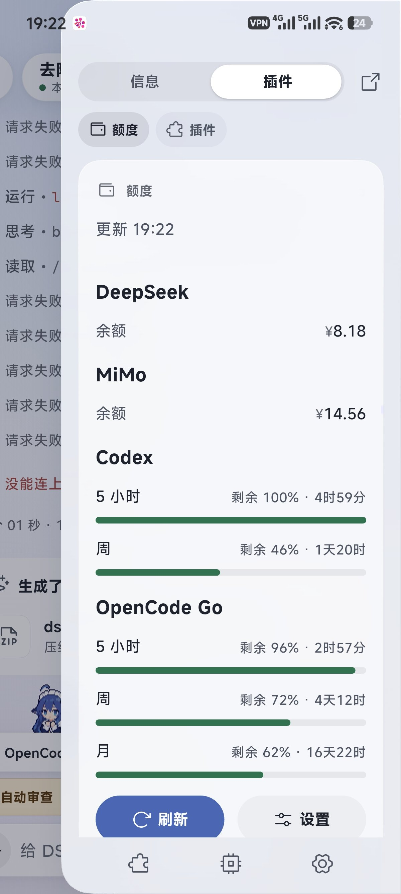

# dsh-usage-dock

[](https://www.npmjs.com/package/dsh-usage-dock)
[](https://github.com/Slacom/dsh-usage-dock/blob/main/LICENSE)

DeepSeek Harness（DSH）的侧栏套餐用量插件：在左侧栏底部显示余额和剩余额度，点击展开详情。

## 界面预览

### 桌面端


### DSH Go



## 支持渠道

| 渠道 | 数据来源 | 显示内容 |
| --- | --- | --- |
| DeepSeek | DSH 账号余额优先，开放平台 API Key 回退 | 余额（含赠金）；账号模式附峰谷时间条 |
| Xiaomi MiMo | 开放平台 API Key（`mimoApiKey`，或「设置 → 模型」里的 MiMo Key） | 总余额、现金及赠送余额 |
| OpenCode Go | OpenCode usage API（Bearer） | 5 小时 / 周 / 月窗口（按账户实际返回） |
| OpenAI Codex | 本插件内登录 ChatGPT 账号（设备码，最多 8 个账户） | 5 小时 / 周（账户实际返回的窗口） |
| **自定义余额渠道** | 你选择的模型来源 + 该来源下的余额接口路径 | 该接口返回的余额（币种来自条目或可信采样） |

- 每 **30 秒**刷新；展开面板、窗口聚焦、页面重新可见时立即刷新。
- 短暂网络失败保留旧值（灰化显示），持续失败后才报告错误；未登录、缺凭据、鉴权失败等错误立即显示。
- 胶囊独占侧栏底部一行；侧栏折叠时只显示圆点，不可点击。
- 设置页可开关渠道、配置凭据、设置余额告警阈值与显示顺序；内置与自定义渠道在同一列表里混排。
- 余额向下取整到分。DeepSeek / MiMo 的「侧栏显示告警额度」默认 10 元，填 0 不告警。
  这个告警只影响侧栏胶囊状态灯，和「额度策略」是两套设置。

## 使用说明

### DeepSeek
优先读取并显示DSH所登录账号的余额

当未登录账号或读取失败时，回退到「设置 → 模型」中官方DeepSeek渠道所配置的 API Key。

### Xiaomi MiMo 及 OpenCode Go

默认使用「设置 → 模型」中按照官方预设渠道所配置的 API Key

也可以在「设置 → 内置插件 → Usage Dock → Xiaomi MiMo/OpenCode Go」填写其他 API Key

### OpenAI Codex

在「设置 → 内置插件 → Usage Dock → OpenAI Codex」点「添加账户」，按页面提示完成 ChatGPT
设备码授权即可读取额度。插件只使用自己的 ChatGPT 账号登录，不依赖其它 Codex 插件。

- 最多保存 **8 个账户**，同一时间只有一个账户生效；胶囊与详情只显示当前选中账户的数字。
- 支持添加账户、同账号重新登录、切换当前账户、移除账户；移除最后一个账户后回到未登录状态。
- 令牌只保存在 Host 侧的本插件凭据记录中，不下发浏览器、不写配置、不回显到页面。
- 额度读取使用 Codex 客户端所用的接口，属于非官方支持用法，上游改版时可能失效。

**注意，当前登录、重新登录、移除只能在桌面端或Web页面的设置选择**

**DSH Go 原生设置页目前只能查看并选择账户，不能完成登录或退出**

### 自定义余额渠道

在「设置 → 内置插件 → Usage Dock」里可以添加多条自定义渠道。每条选择一个**已在「设置 → 模型」中
配置的来源**，再填写该来源下的余额接口路径：

| 字段 | 说明 |
| --- | --- |
| 名称 | 仅用于显示；同名多条互不影响 |
| 余额来源 | 只能从已配置的模型来源里选择，不需要另填 URL 或 Key |
| 余额接口路径 | 相对该来源路径的后缀，例如 `/v1/credits` 或 `/balance` |
| 结果 JSON 键路径 | 例如 `data.balance`、`balance_infos[0].total_balance` |
| 币种（可选） | 目前可显示为¥与$，留空不显示|

可选「扣减键」表达 `余额键 − 扣减键`，用于「累计额度 − 累计用量」这类响应。

能力边界：

- 只支持 `GET` + `Authorization: Bearer <凭据>` + JSON 响应；不做 Cookie、OAuth、签名、
  GraphQL、网页抓取或特殊厂商适配。
- 键路径只支持字段名与数组下标，不执行任何表达式（没有通配、过滤器或 eval）。
- 只访问你明确选择的模型来源派生出的主机与相对路径；不跟随重定向，TLS 证书校验始终开启。
- 「累计额度」不等于「余额」。若上游返回累计充值 / 累计用量，请同时填扣减键；只填一个累计键
  会得到累计值，不会自动换算。
- 每条独立：一条失败不影响其他条目；改来源、路径、币种或凭据后，该条旧值与在途请求立即作废。
- 凭据由 DSH 的模型配置管理：插件按你选定的来源解析并使用它，不会另存一份到自定义条目里，
  设置页也不回显任何已保存的凭据值。

**注意，当前自定义余额渠道只能在桌面端或Web页面中设置并显示**

## 只读额度查询（模型工具）

插件注册一个只读工具 `usage_status`，让模型可以主动查询自己需要的那几个渠道：

- 查询范围：给了 `ids` → 只查「点名 ∩ 已启用 ∩ 受支持」的渠道；省略 `ids` 或传空数组 →
  查询当前全部已启用且受支持的渠道。停用的渠道不取数、不发凭据。
- 不继承「额度策略」的关注名单——关注名单只影响自动提示，与主动查询不同。
- 输出是脱敏投影：渠道状态、余额与币种、各窗口剩余百分比、采样时间；不含 URL、账号、Key、
  Cookie、上游原文或内部指纹。
- 结果有短暂成功缓存与请求合并；超时只标「本次没有」而不报错，失败可立即重试。
- 缺少工具服务时静默跳过，不影响胶囊与设置页。

## 安装 / 更新

目标环境是提供官方 Web 插件席位、Config schema 与 configForms 的 DSH 0.2.0 系列；
安卓端包括基于 `0.2.0-rc.2` 的 DSHA / DeepCode 移植环境。不同移植版本仍需核对宿主 API。

```sh
dsh plugin --profile web add dsh-usage-dock
```

桌面端按实际 profile 使用 `--profile desktop`；也可在「设置 → 插件」添加包名。
安装后重启 DSH / 安卓引擎，再刷新网页或重新打开 WebView。

DSH Go 原生面板、权限与安装说明：见 [DSH Go 原生面板](docs/dsh-go-native-panel.md)。

## 安卓 / DSH Go 兼容性

目前大部分内容已针对DSH Go进行了兼容，基本所有功能均可以在Web页面下正常显示

基本功能可以在DSH Go原生页面正常运行，并调整了UI显示，但部分功能由于原生页面显示逻辑不同，暂不支持。

## 设置

进入「设置 → 内置插件 → Usage Dock」，更改后点击「保存更改」。配置通过 DSH 的
`Config` / `configForms` 托管到 profile Cordis patch，不是独立 JSON 配置文件。
Host 存在 `configEditor` 时读取最新配置（2 秒内复用）；缺少该服务的移植宿主需重启引擎
才能让凭据和 Host 渠道开关生效。客户端显示过滤仍订阅表单实时变化。

| 渠道 | 配置字段 / 登录方式 |
| --- | --- |
| DeepSeek | `deepseekApiKey`；账号服务可用时无需 Key；`deepseekWarnThreshold` |
| Xiaomi MiMo | `mimoApiKey`；留空自动回退官方默认第三方供应商中所配置的 Key；`mimoWarnThreshold` |
| OpenAI Codex | 在本插件内「添加账户」完成 ChatGPT 设备码登录（最多 8 个账户，单选生效） |
| OpenCode Go | `apiKey`，留空自动回退官方默认第三方供应商中所配置的 Key |
| 自定义余额 | `customBalances`（来源、路径、币种等公开元数据）；凭据使用该来源在「设置 → 模型」里的配置 |

保存会先校验再一次性提交，点「放弃更改」全部回到上次保存的状态。

### 额度策略（模型提示，可选）

每个渠道卡片底部都有「关注额度策略」与两档阈值（预警 / 收尾）。

该功能可以将当前会话所用供应商的额度信息注入上下文中，并为模型提供不同额度阶段的建议，
可用于避免由于额度耗尽导致会话中断的情况发生。

预警 / 收尾建议生效，需要同时满足：

1. 页面顶部「启用额度策略（总开关）」打开（默认关）。插件会按本次请求已观察到的供应商路由，
   自动匹配你已勾选「关注」的渠道；
2. 所需关注的渠道勾选了「关注额度策略」；
3. 该渠道配置了有效阈值（0 = 未配置，不会自动补默认值）；
4. 会话里本次已观察到的路由确实指向该渠道。主会话与子 Agent 各按自己已观察到的路由判定；
   未关注、未知或歧义路由不注入任何额度事实与规则。

总开关已启用、路由已确认且来源与采样有效性检查通过时，额度快照（余额 / 各窗口剩余）会作为事实
呈现；没有有效阈值时只给事实，不给预警 / 收尾建议。总开关关闭时，额度事实与规则都不注入。

- **金额型**（DeepSeek / MiMo / 自定义余额）：填两个该渠道实际币种的数值；币种未知时输入框禁用，
  插件不会猜成 CNY。
- **订阅型**（Codex / OpenCode Go）：按实际采样到的窗口分别填两档剩余百分比；本次采样没有出现的
  窗口不显示输入框（已保存的配置会保留，但暂不参与判定）。
- 各窗口独立判定、渠道整体取最严重（收尾 > 预警），提示里会写明是哪个窗口、当前多少触发。
- 窗口列表来自插件已有的采集观察（只读元数据路由 `/api/plan-usage/quota-windows`），
  不会因此额外解析凭据或请求任何供应商；「刷新窗口信息」按钮只重读这份状态。


## 卸载

```sh
dsh plugin --profile web remove dsh-usage-dock
```

MIT；沿用上游许可证。
